# Mise image approach samples · 31 October 2026

Twelve selected generated images: three dishes × four approaches. Each original is 1536 × 1024 (3:2). These are synthetic food images for style review, not photographs of dishes actually cooked.

**Status:** Saved to a separate Git review branch at Jordan’s request. No recipe image mappings, website code, main branch, deployment or 20-recipe pilot changes are included.

## Browse the samples

| Dish | 01 Cookbook | 02 Overhead | 03 Close-up | 04 Painted |
| --- | --- | --- | --- | --- |
| Dal Tadka | [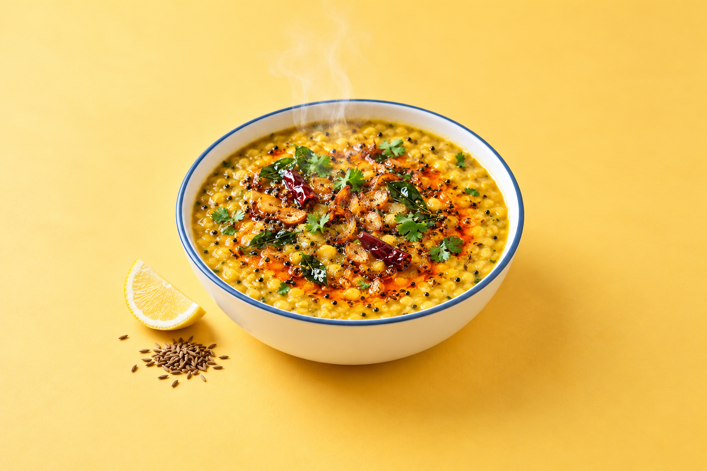](images/dal-01-cookbook.png) | [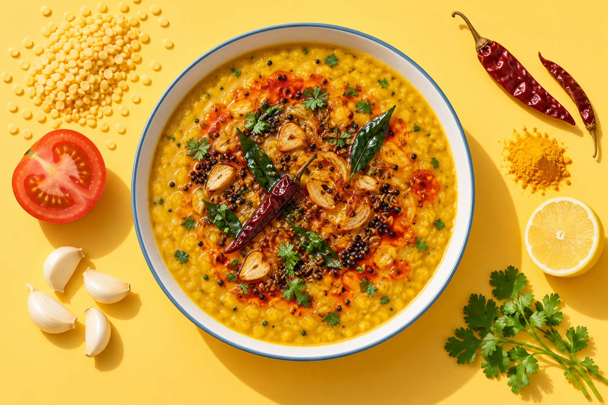](images/dal-02-overhead.png) | [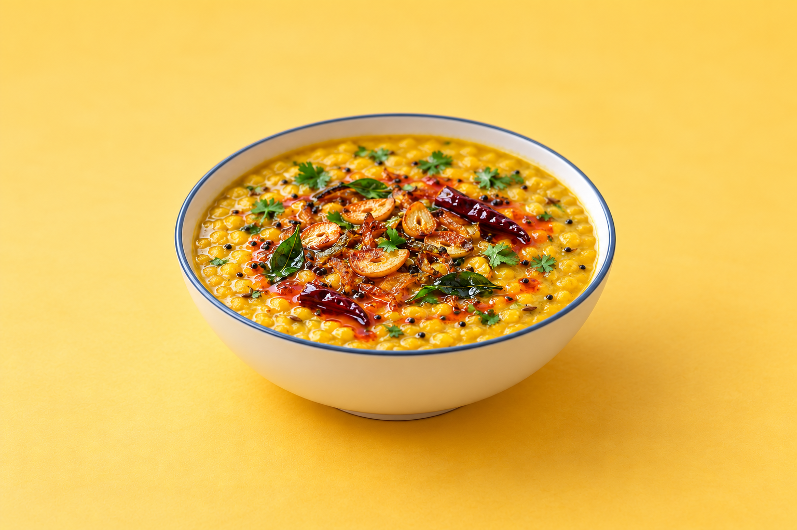](images/dal-03-closeup.png) | [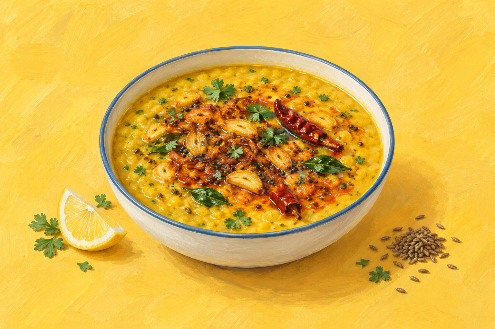](images/dal-04-painted.png) |
| Beef and Broccoli | [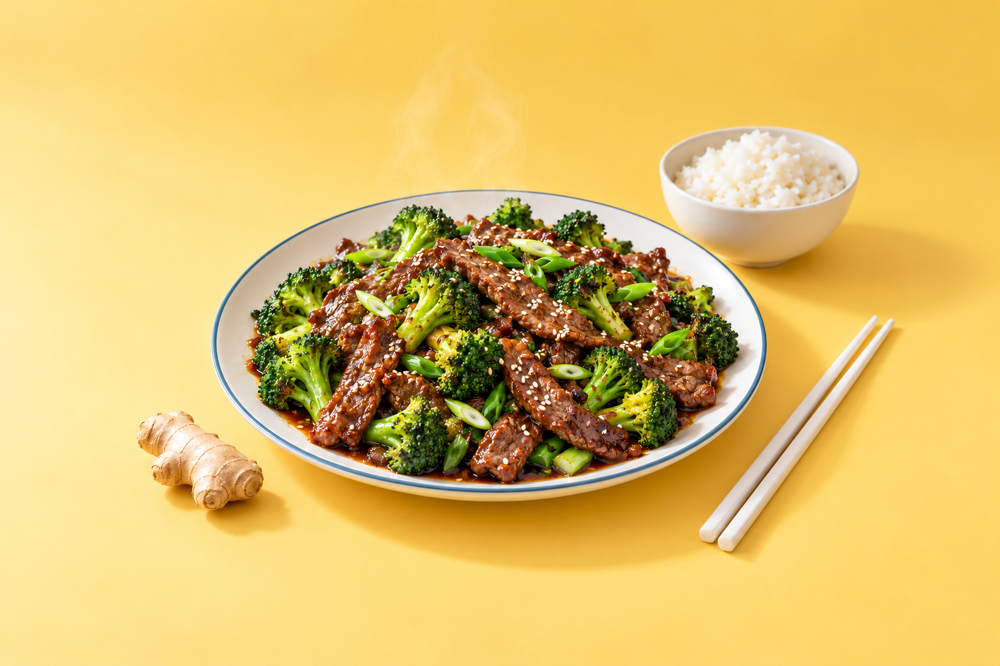](images/beef-01-cookbook.png) | [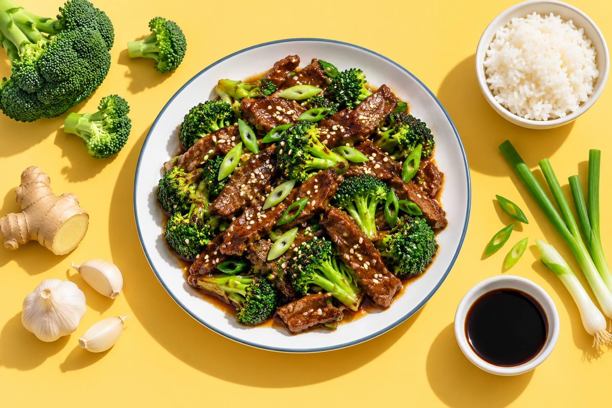](images/beef-02-overhead.png) | [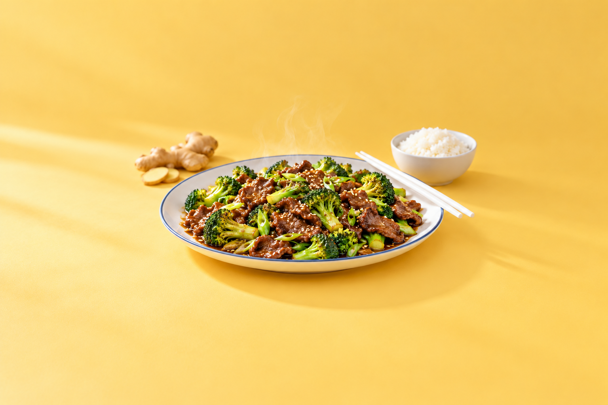](images/beef-03-closeup.png) | [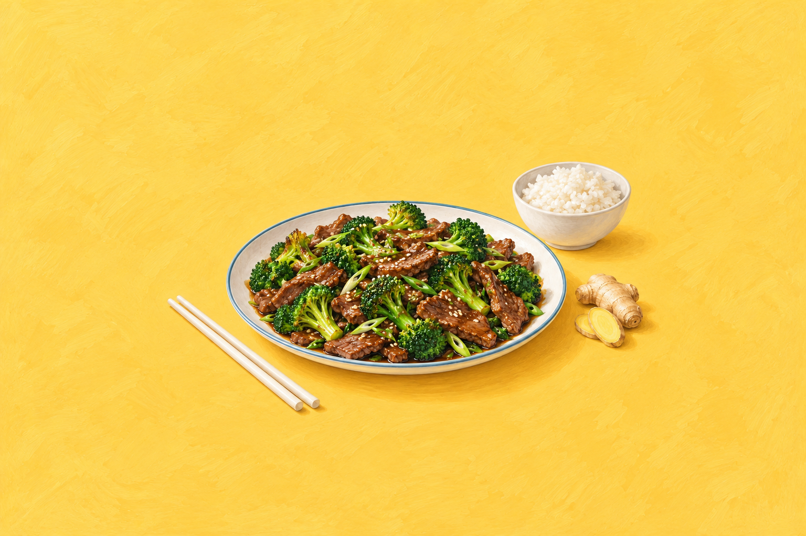](images/beef-04-painted.png) |
| Steven’s Margarita | [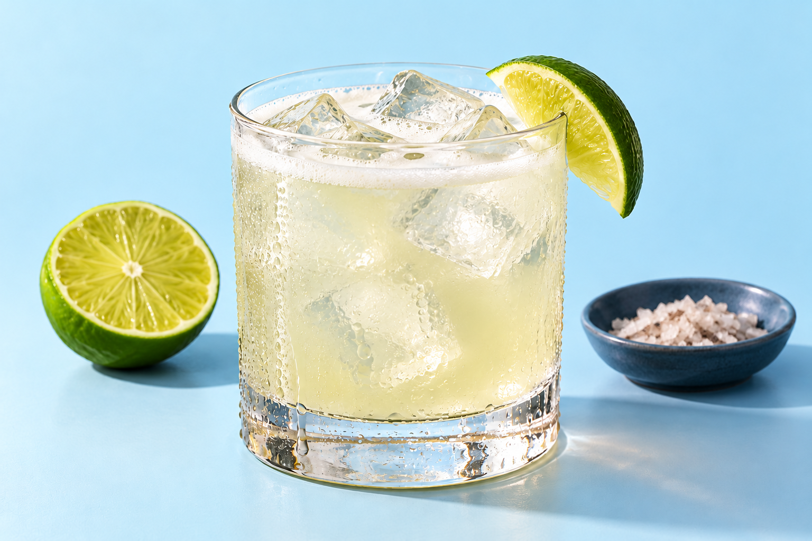](images/margarita-01-cookbook.png) | [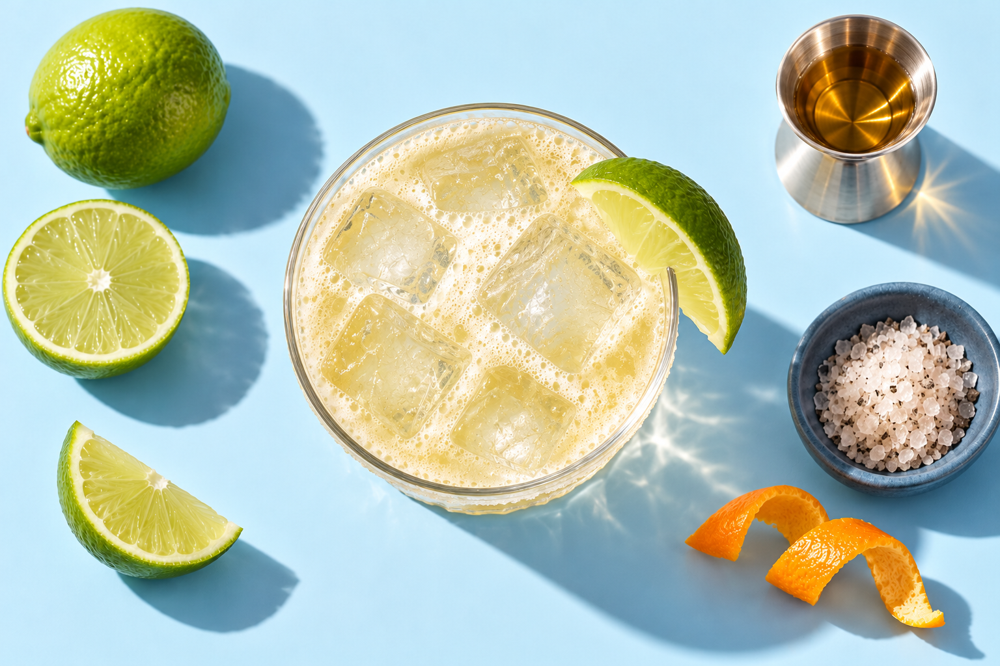](images/margarita-02-overhead.png) | [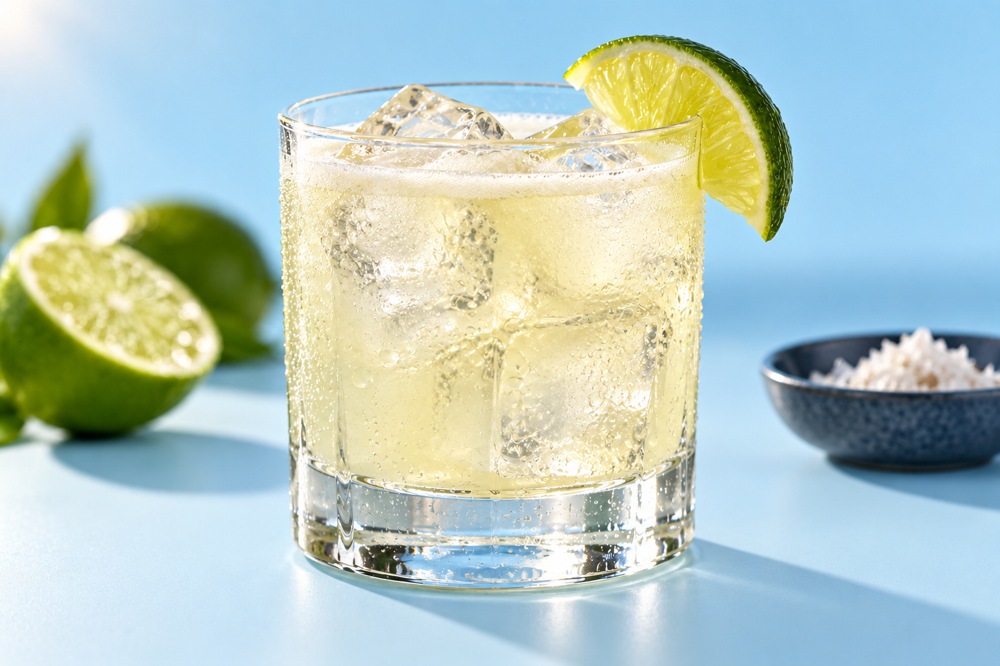](images/margarita-03-closeup.png) | [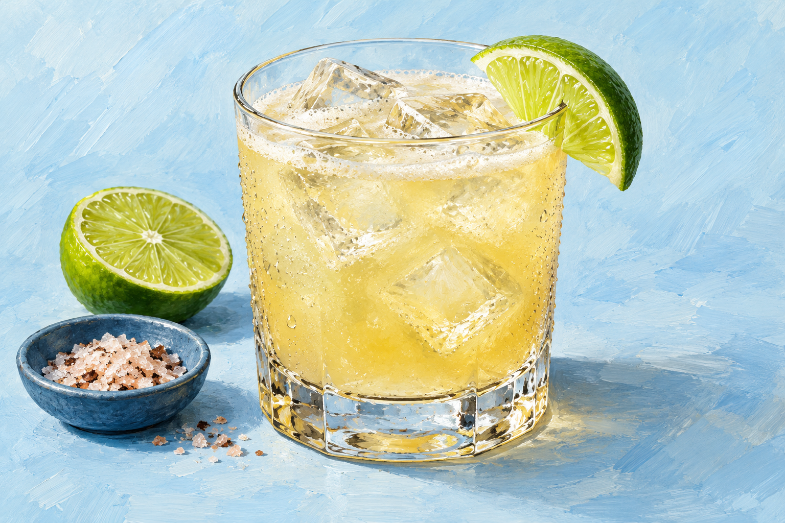](images/margarita-04-painted.png) |

## Prompts and review notes

- [Full assessment and recommended next-pilot master prompt](README.txt)
- [Exact Dal prompts and framing corrections](prompts/dal.json)
- [Exact Beef prompts and framing corrections](prompts/beef.json)
- [Original Margarita prompts](prompts/margarita-original.json)
- [Margarita revisions](prompts/margarita-revisions.json)
- [File sizes, SHA-256 hashes, Git blob hashes and image dimensions](manifest.json)

README.txt preserves the original delivered assessment. Its statement that the recipe repository had not changed describes the pre-upload delivery state; this branch subsequently adds this review package only.

Recommendation: **01, bright cookbook photography**, as the default. The other approaches and their limitations remain available for comparison. No style selection is assumed. The next 20-image pilot awaits Jordan’s choice. Crop safety was visually reviewed; exact angles, backdrop hex values and every garnish detail are not guaranteed.

This branch is based on `images/approaches` commit `5907f11a4ad65d95bce58287756ad71870b5174b`, preserving the existing prompt-template work. No rejected variants, duplicate ZIPs or private operational files are included.
