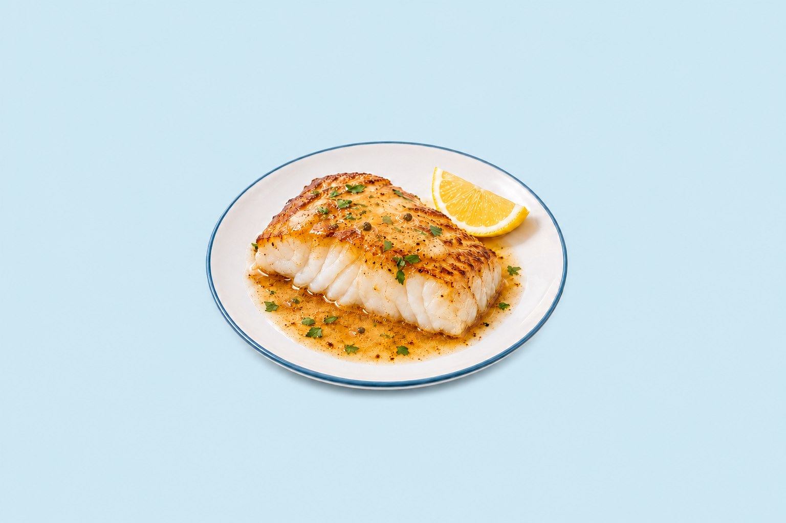
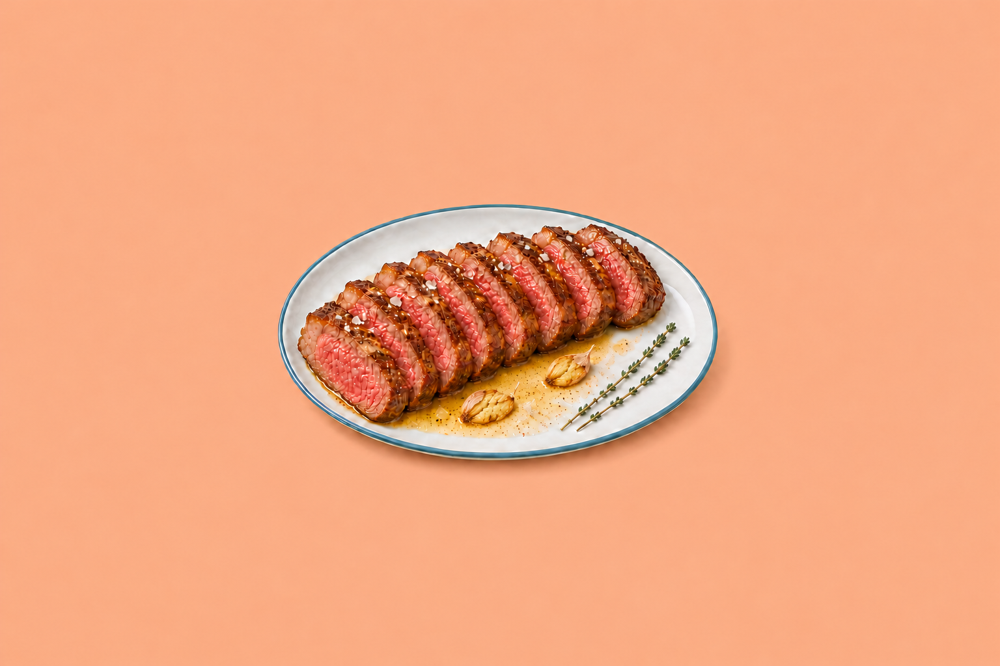
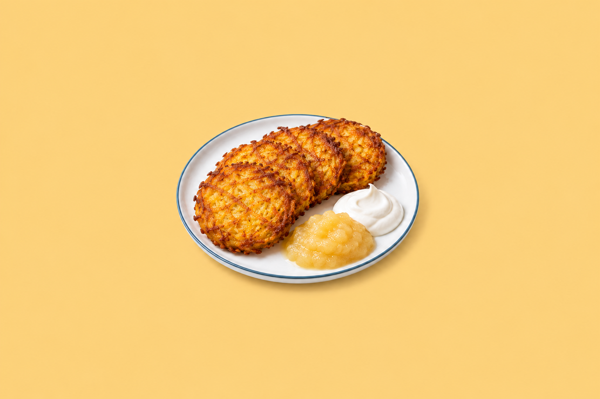
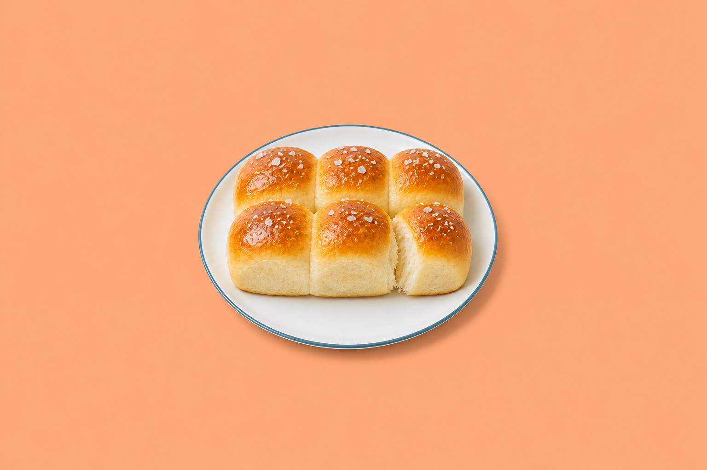
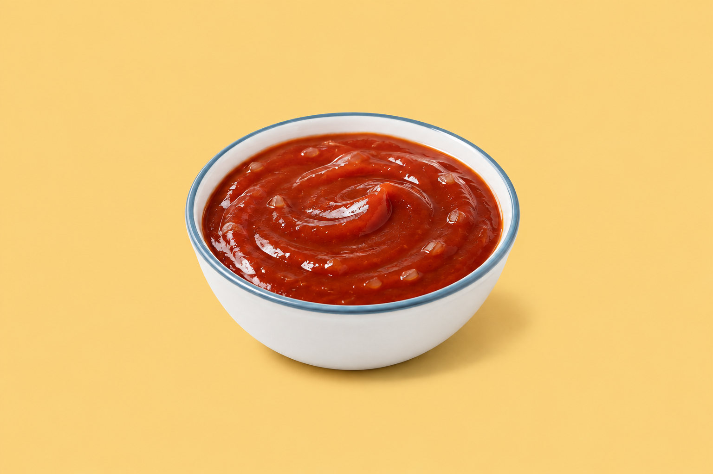
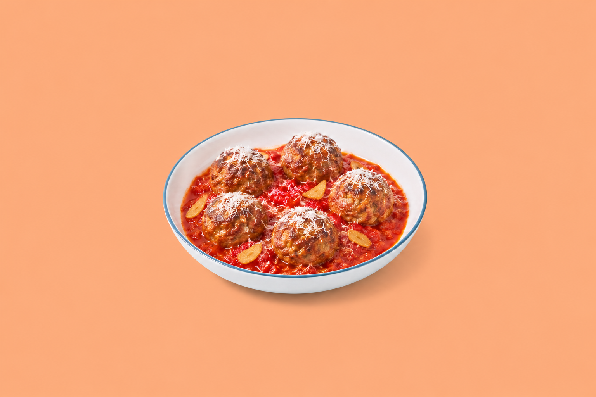
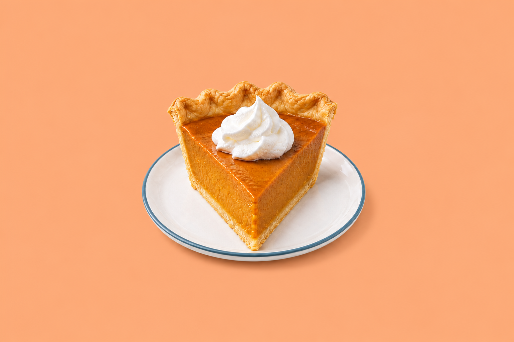

# Mise batch 17 redo

Seven cookbook photographs for visual review, generated November 11, 2026.
The files are not mapped into recipes and are not used by the live site.

## Review scope

- Branch: `images/mise-batch-17-redo-2026-11-11`.
- Base: `aa1ecc80410d3d0ba3778c682413195250d81833` (the accepted batch 17 site update).
- Format: native PNG, 1536 × 1024, landscape 3:2.
- Images: the seven exact requested filenames under `images/`.
- Method: built-in image generation, with the specified margarita style reference attached to every generation and revision.
- Reference: [`margarita-01-cookbook.png`](https://github.com/jsilton/mise/blob/ef362c8c1e83bf6114f4b1a420c543adc4c33f80/docs/image-tests/2026-10-31/images/margarita-01-cookbook.png).

No recipe edits, image mapping, production code, website configuration, merge or deployment are included. Previous images are preserved.

## Photos

### Pan-Seared Cod with Brown Butter and Lemon

Tiny irregular dark capers, flaky white cod and a pale sky blue backdrop.

### Pan-Seared Steak with Butter Baste

Eight whole slices in one row, two smashed garlic cloves, and two straight thyme sprigs on apricot.

### Classic Potato Latkes

Four compact round latkes with tight crisp edges, applesauce and sour cream on butter yellow.

### Soft Dinner Rolls

Six rolls in two rows of three, fully on the plate, with a small plain-bread torn seam on apricot.

### BBQ Sauce

The accepted sauce styling on butter yellow.

### Beef and Pork Meatballs in San Marzano Sauce

Five meatballs with irregular golden garlic slices on apricot.

### Pumpkin Pie

The accepted point-forward wedge with one dollop of cream on apricot.

## Checks and provenance

`prompt-specification.txt` preserves the supplied brief. `generation-prompts.json` records the exact generation and revision prompts. `qa.json` records the full-set visual review and technical checks, including PNG readability, dimensions, filenames and SHA-256 checksums.

Each image was inspected for the specified food and count, its individual correction, vessel and garnish, no steam or props, centered scale, a safe middle-half crop, and an even backdrop. Background colors are visually close to the requested hex values, not mathematically pixel-identical; sampled values are recorded in the QA file. Small neutral contact shadows remain intentionally.

Only review assets and their documentation are added, so application build, recipe validation and deployment tests are not required for these files and were not run. Image integrity and scope checks were run. The repository's deployment workflow runs on `main`, not this review branch.
